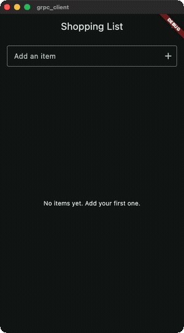

# Flutter gRPC Shopping List

A shopping list that shows gRPC end to end: a Dart gRPC server, a Flutter client, and one shared
`.proto` contract. The list updates live on every connected client through a server stream.



## How gRPC works

- **gRPC** (gRPC Remote Procedure Calls) lets one program call a function in another program over
  the network, as if it were a local method call. Each such call is an **RPC** (Remote Procedure
  Call).
- **Proto file**: the contract. It lists the available calls (RPCs) and the shape of each request
  and response. Both sides are generated from it, so they always agree.
- **Server**: implements those calls (here, in Dart) and keeps the data.
- **Client**: calls them through generated code (here, the Flutter app) and shows the result.

```
 shopping.proto
   |  generates Dart code for both sides
   v
 Flutter client  --- request ------>  Dart server
 (calls RPCs)    <-- response ------  (implements RPCs)
                 <== stream ========  (pushes list updates)
```

Most calls are one request and one response. `WatchItems` is a server stream: the client asks once
and the server keeps sending the updated list.

## Features

- Add, check off and delete items
- Clear all bought items at once
- Live updates: the client subscribes to a `WatchItems` server stream, so changes from any client
  appear instantly
- Typed gRPC errors (`invalidArgument`, `notFound`) shown as messages in the app
- Light and dark theme, retry when the server is unreachable

## Run

Start the server (in-memory list, port 50051):

```sh
cd grpc_server
dart pub get
dart run bin/server.dart
```

Run the client on macOS, iOS simulator or Android emulator:

```sh
cd grpc_client
flutter pub get
flutter run
```

The client connects to `localhost` (`10.0.2.2` on the Android emulator). For a physical device, pass
the server machine's address:

```sh
flutter run --dart-define=SERVER_HOST=192.168.1.20
```

`SERVER_PORT` is also supported.

## The contract

[`protos/shopping.proto`](protos/shopping.proto) defines `ShoppingService`:

| RPC           | Type             | Purpose                                     |
|---------------|------------------|---------------------------------------------|
| `AddItem`     | unary            | Add an item, returns it with its id         |
| `ListItems`   | unary            | Current list                                |
| `SetBought`   | unary            | Mark an item bought or not                  |
| `DeleteItem`  | unary            | Remove an item                              |
| `ClearBought` | unary            | Remove all bought items                     |
| `WatchItems`  | server streaming | Current list, then again after every change |

## Project layout

```
protos/        shopping.proto, shared by both apps
grpc_server/   Dart server: bin/server.dart, lib/shopping_service.dart, tests
grpc_client/   Flutter app: lib/data (gRPC client), lib/features/shopping (UI), tests
```

Regenerate the Dart code after editing the proto (needs `protoc` and
`dart pub global activate protoc_plugin`):

```sh
protoc --dart_out=grpc:grpc_server/lib/generated -Iprotos protos/shopping.proto
protoc --dart_out=grpc:grpc_client/lib/generated -Iprotos protos/shopping.proto
```

## Test

```sh
cd grpc_server && dart test
cd grpc_client && flutter test
```

The server tests run a real in-process gRPC server. The client tests use a fake client to cover the
UI states.

## License

[MIT](LICENSE)
